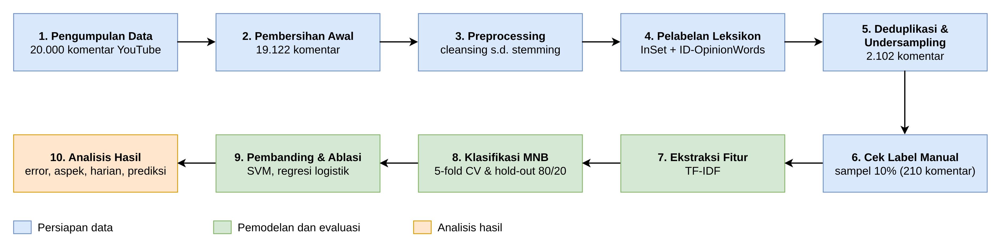
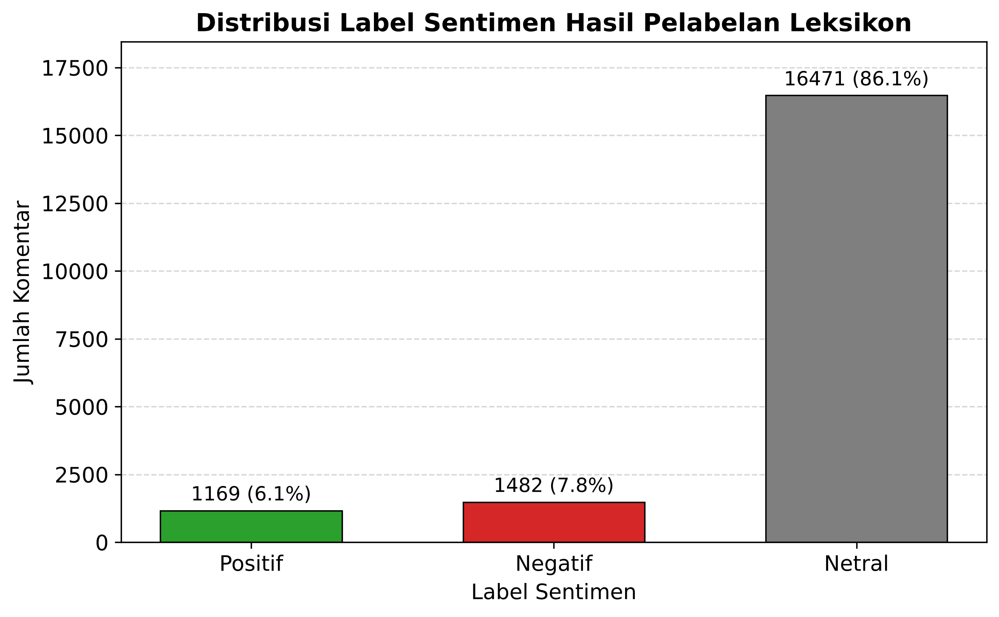
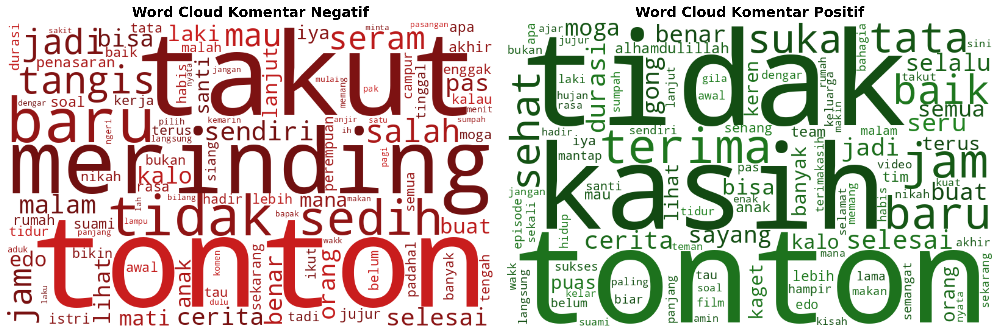
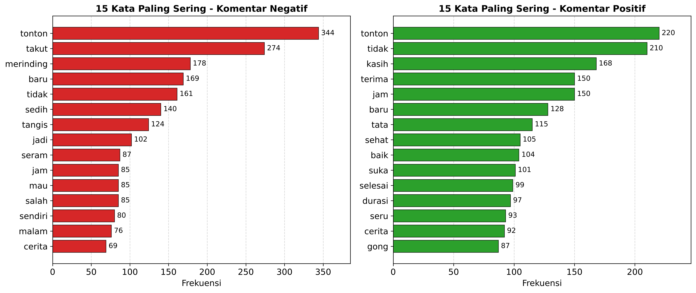
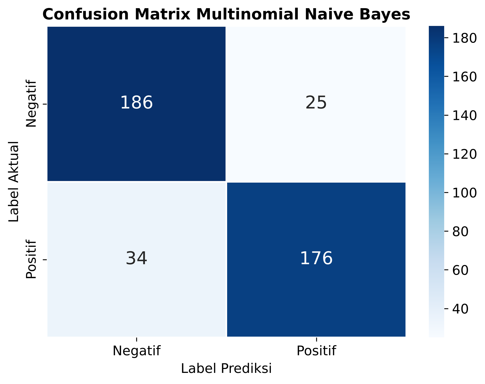
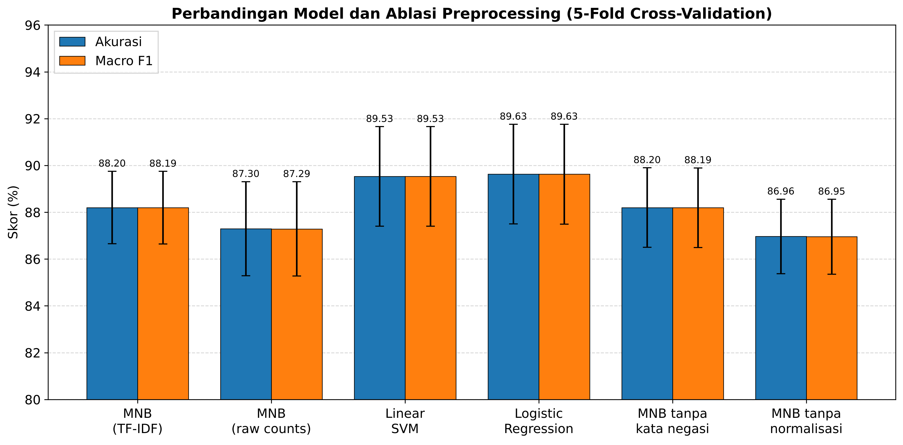
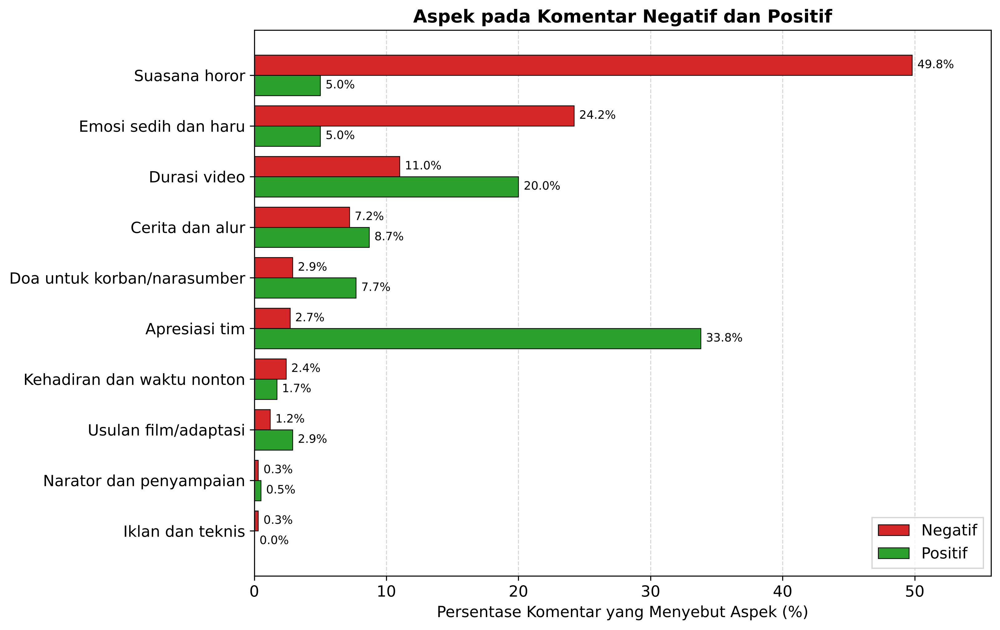
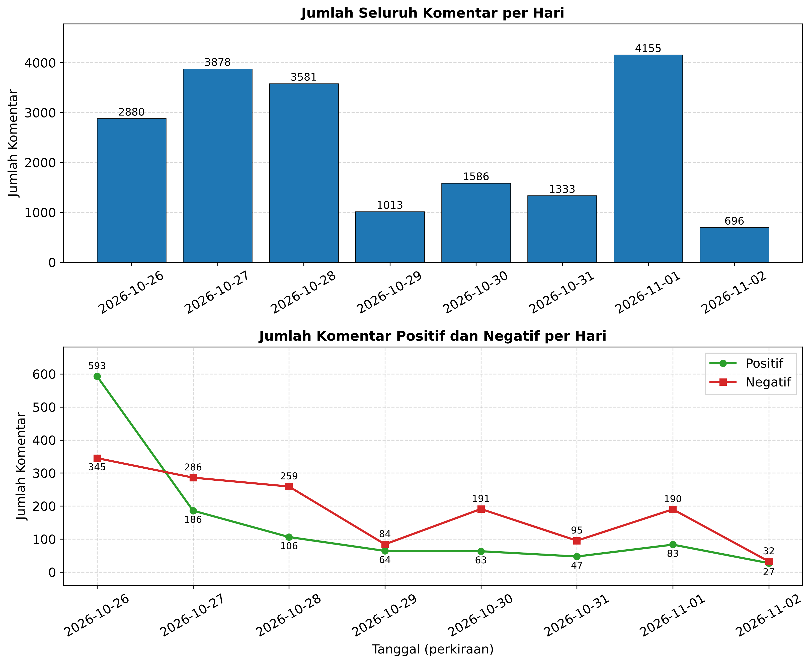
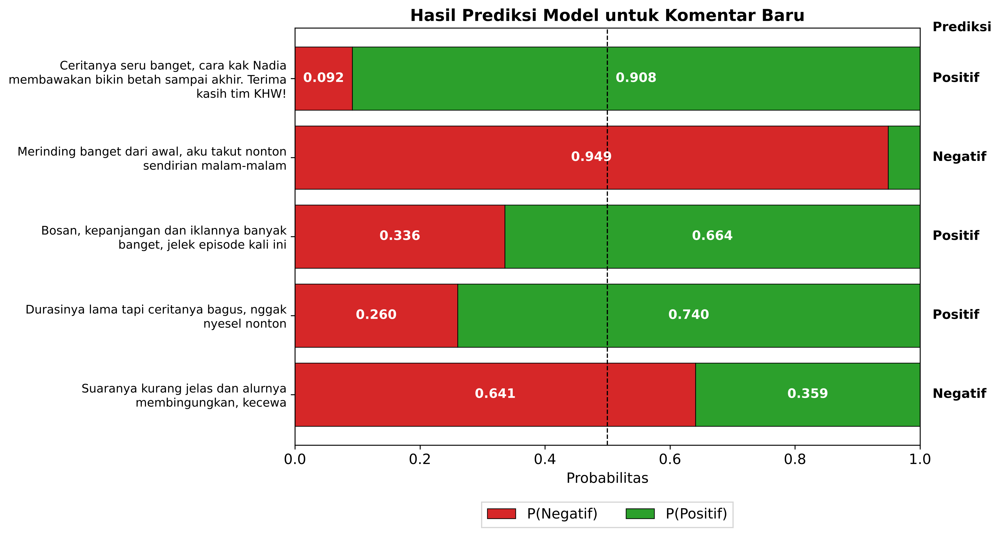

# Analisis Sentimen Komentar YouTube KHW Part 400 dengan Multinomial Naïve Bayes

[](https://www.python.org/)
[](https://scikit-learn.org/)
[](https://github.com/har07/PySastrawi)
[](https://colab.research.google.com/github/Septriansyah/analisis-sentimen-khw400/blob/main/Analisis_Sentimen_KHW400_MNB.ipynb)

Repositori ini berisi kode, data, dan hasil analisis sentimen terhadap 19.122 komentar YouTube pada video **KHW Part 400** di kanal Nadia Omara. Saya melabeli komentar dengan leksikon sentimen bahasa Indonesia, lalu melatih model **Multinomial Naïve Bayes (MNB)** dengan fitur TF-IDF. Alur analisisnya sama dengan artikel saya tentang ulasan aplikasi Gauth: cek label manual, perbandingan dengan model lain, ablasi preprocessing, analisis error, dan analisis aspek per hari.

## Ringkasan hasil

| Ukuran | Nilai |
|---|---|
| Komentar yang dianalisis | 19.122 (dari 20.000 hasil crawling) |
| Komentar berlabel positif / negatif | 1.169 / 1.482 (16.471 lainnya netral) |
| Dataset seimbang untuk pelatihan | 2.102 komentar (1.051 per kelas) |
| Label leksikon yang sesuai dengan teks (cek 210 sampel) | 72,4% |
| Akurasi MNB, 5-fold cross-validation | **88,20% ± 1,55** |
| Akurasi MNB, data uji hold-out | 85,99% (macro F1 0,860) |
| Akurasi tertinggi | Regresi logistik, 89,63% ± 2,13 |

> [!IMPORTANT]
> Label di repositori ini berasal dari leksikon, bukan dari anotasi manusia. Akurasi di atas mengukur seberapa dekat MNB meniru label leksikon. Pada cek 210 komentar, label leksikon sesuai dengan isi teks pada 72,4% kasus.

**Temuan utama**

1. Rasa takut dan sedih mengisi sebagian besar komentar negatif. Sebanyak 49,8% komentar negatif menyebut suasana horor dan 24,2% menyebut emosi sedih. Keluhan tentang iklan atau kualitas teknis hanya muncul pada 0,3% komentar negatif.
2. Komentar positif berisi apresiasi untuk Nadia Omara dan tim (33,8%) dan sering menyebut durasi video yang hampir tiga jam (20,0%).
3. Pada hari pertama data (26 Oktober 2026), 37% komentar berlabel bernada negatif. Pada hari-hari berikutnya porsinya 54% sampai 75%.
4. Regresi logistik (89,63%) dan SVM linear (89,53%) sedikit lebih akurat daripada MNB (88,20%). Setiap parameter MNB berupa peluang kata per kelas, jadi prediksinya tetap bisa dihitung ulang dengan tangan.
5. Dari 59 kesalahan model pada data uji, 31 terjadi pada komentar yang label leksikonnya keliru.

## Daftar isi

- [Data](#data)
- [Alur penelitian](#alur-penelitian)
- [Preprocessing](#preprocessing)
- [Pelabelan dengan leksikon](#pelabelan-dengan-leksikon)
- [Dataset akhir dan cek label](#dataset-akhir-dan-cek-label)
- [Kata yang paling sering muncul](#kata-yang-paling-sering-muncul)
- [Perhitungan MNB](#perhitungan-mnb)
- [Hasil evaluasi](#hasil-evaluasi)
- [Analisis error](#analisis-error)
- [Aspek di balik sentimen](#aspek-di-balik-sentimen)
- [Komentar per hari](#komentar-per-hari)
- [Prediksi komentar baru](#prediksi-komentar-baru)
- [Keterbatasan](#keterbatasan)
- [Cara menjalankan](#cara-menjalankan)
- [Struktur repositori](#struktur-repositori)
- [Referensi](#referensi)

## Data

Saya mengumpulkan komentar video KHW Part 400 pada 2 November 2026. Setiap baris berisi teks komentar, jumlah *like*, dan waktu unggah relatif seperti "6 days ago". Komentar yang kosong setelah emoji dan *mention* dihapus (umumnya komentar yang hanya berisi emoji) saya buang.

| Keterangan | Nilai |
|---|---|
| Komentar hasil crawling | 20.000 |
| Komentar kosong setelah pembersihan awal | 878 |
| Komentar yang dianalisis | 19.122 |
| Balasan (*reply*) | 243 (1,3%) |
| Rata-rata panjang komentar | 5,1 kata |
| Rentang tanggal (perkiraan) | 26 Oktober s.d. 2 November 2026 |

File [`data/komentar_khw400_clean.csv`](data/komentar_khw400_clean.csv) berisi kolom `text_original`, `like_count`, `time`, dan `clean_comment`. Nama akun sudah saya hapus.

## Alur penelitian



Diagram ini saya buat di draw.io. File sumbernya, [`figures/alur_penelitian.drawio`](figures/alur_penelitian.drawio), bisa dibuka dan diedit di [app.diagrams.net](https://app.diagrams.net). Semua langkah acak (sampling, pengacakan, dan pembagian data) memakai *seed* 42, jadi hasilnya sama setiap kali notebook dijalankan.

## Preprocessing

Saya memproses kolom `text_original` dalam enam tahap. Kolom `clean_comment` tidak dipakai untuk pemodelan karena pembersihan awal ikut membuang kata negasi seperti *tidak* dan *belum*.

| Tahap | Isi |
|---|---|
| Cleansing | Normalisasi Unicode NFKC, hapus emoji, URL, *mention*, angka, dan tanda baca, lalu ringkas huruf berulang (*iniiii* → *ini*) |
| Case folding | Mengubah semua huruf menjadi huruf kecil |
| Tokenizing | Memecah teks berdasarkan spasi |
| Normalisasi | Kamus *Colloquial Indonesian Lexicon* (4.331 bentuk slang) ditambah 55 entri khusus, misalnya *gak* → *tidak*, *nad* → *nadia*, *makasih* → *terima kasih* |
| Stopword removal | Daftar Sastrawi ditambah partikel dan sapaan (*sih*, *deh*, *kak*, *wak*), total 182 kata. Delapan kata negasi dan kemampuan (*tidak*, *belum*, *bukan*, *kurang*, *tanpa*, *nggak*, *bisa*, *guna*) tetap dipertahankan |
| Stemming | Stemmer Sastrawi (algoritma Nazief-Adriani) dengan 12 pengecualian, misalnya *menangis* → *tangis* karena Sastrawi menghasilkan *menang* |

**Contoh satu komentar melewati enam tahap**

| Tahap | Hasil |
|---|---|
| Teks asli | makasih ya kak nad, sukses sllu, sehat sellu panjang usia utk kak nad dan semua tim lup yuuu 🤗🤗🤗 |
| Cleansing | makasih ya kak nad sukses sllu sehat sellu panjang usia utk kak nad dan semua tim lup yu |
| Case folding | makasih ya kak nad sukses sllu sehat sellu panjang usia utk kak nad dan semua tim lup yu |
| Tokenizing | [makasih, ya, kak, nad, sukses, sllu, sehat, sellu, panjang, usia, utk, kak, nad, dan, semua, tim, lup, yu] |
| Normalisasi | [terima, kasih, ya, kak, nadia, sukses, selalu, sehat, sellu, panjang, usia, untuk, kak, nadia, dan, semua, tim, lup, yuk] |
| Stopword removal | [terima, kasih, sukses, selalu, sehat, sellu, panjang, usia, semua, tim, lup] |
| Stemming | [terima, kasih, sukses, selalu, sehat, sellu, panjang, usia, semua, tim, lup] |

## Pelabelan dengan leksikon

Komentar YouTube tidak punya rating bintang, jadi saya memberi label dengan leksikon. Leksikon InSet (3.609 kata positif dan 6.609 kata negatif) ternyata memberi bobot pada banyak kata yang tidak bermakna sentimen di komentar ini, misalnya *mau* (+4), *apa* (−3), dan *tata* (+1), padahal Tata adalah nama tokoh dalam cerita. Saya menyusun leksikon akhir dalam tiga langkah:

1. **Konsensus dua leksikon.** Kata InSet hanya dipakai kalau ID-OpinionWords juga mencatatnya sebagai kata opini dengan polaritas yang sama (969 kata). Kata ID-OpinionWords yang tidak ada di InSet diberi bobot +3 atau −3.
2. **Kata netral konteks.** Sebanyak 115 kata fungsi dan kata yang netral di komentar video (*menonton*, *durasi*, *panjang*, *gua*, *jujur*) dikeluarkan.
3. **Penyesuaian domain.** Sebanyak 27 kata khas komentar YouTube ditambahkan atau diberi bobot ulang, misalnya *gong* (+3), *seru* (+4), *mantap* (+4), *bosan* (−4), dan *jelek* (−4).

Leksikon akhir berisi 3.262 entri. Skor komentar adalah jumlah bobot kata atau frasa (hingga tiga kata) yang cocok. Kata negasi (*tidak, bukan, belum, kurang, jangan, tanpa*) membalik bobot kata sentimen pertama dalam jarak dua token sesudahnya. Skor di atas nol menjadi label positif, skor di bawah nol menjadi label negatif, dan skor nol menjadi netral.

> [!NOTE]
> Label ini mengukur **polaritas teks**. Komentar "merinding banget" berlabel negatif walaupun penulisnya menikmati video. Notebook menyediakan saklar `NEUTRALIZE_STORY_EMOTION = True` untuk menolkan kata emosi seperti *takut* dan *sedih*.



**Distribusi label hasil leksikon**

| Label | Komentar | Persen | Rata-rata kata | Keterangan |
|---|---:|---:|---:|---|
| Positif | 1.169 | 6,1% | 13,4 | Dipakai |
| Negatif | 1.482 | 7,8% | 12,3 | Dipakai |
| Netral | 16.471 | 86,1% | 3,8 | Dikeluarkan |
| **Total** | **19.122** | **100%** | **5,1** | |

Komentar netral rata-rata hanya 3,8 kata. Banyak di antaranya jawaban singkat seperti "Aku" atau "Hadir" untuk komentar ajakan absen, misalnya "yang nonton tanggal 2 absen".

<details>
<summary><b>Kata leksikon yang paling sering menentukan label</b></summary>

| Kata atau frasa | Frekuensi | Bobot |
|---|---:|---:|
| takut | 392 | −4 |
| merinding | 257 | −3 |
| sedih | 205 | −5 |
| terima kasih | 172 | +4 |
| menangis | 167 | −5 |
| seram | 142 | −4 |
| suka | 116 | +3 |
| sehat | 108 | +3 |
| seru | 107 | +4 |
| sayang | 99 | +3 |

Daftar lengkap (30 kata) ada di [`hasil/kata_leksikon_tersering.csv`](hasil/kata_leksikon_tersering.csv).

</details>

## Dataset akhir dan cek label

Dari 2.651 komentar berlabel, saya menggabungkan 253 komentar yang identik setelah preprocessing di bawah label mayoritasnya (tidak ada label yang seri). Tersisa 1.347 komentar negatif dan 1.051 komentar positif. Saya lalu mengambil acak 1.051 komentar negatif, sehingga dataset akhir berisi 2.102 komentar yang seimbang.

Untuk memeriksa label, saya mengambil sampel berstrata sebesar 10% dari dataset akhir (210 komentar, 105 per kelas) dan menandai setiap label sebagai *sesuai*, *bertentangan*, atau *tidak jelas*.

| Label | Sesuai | Bertentangan | Tidak jelas | Total |
|---|---:|---:|---:|---:|
| Negatif | 76 | 6 | 23 | 105 |
| Positif | 76 | 9 | 20 | 105 |
| **Total** | **152 (72,4%)** | **15 (7,1%)** | **43 (20,5%)** | **210** |

Komentar *tidak jelas* umumnya tidak berpolaritas. Contohnya "22:16 kak (maluku)🙋‍♀" yang terlabel negatif karena stemmer memotong *maluku* menjadi *malu*. Banyak komentar *bertentangan* berasal dari negasi yang salah dibaca. Komentar "aku nih kakk dari jam 7 tdii sampe skrng belum seleseee tkuttt" terlabel positif karena *belum* membalik bobot *takut*.

> [!NOTE]
> Cek label dan pengodean error pada versi ini adalah pemeriksaan awal yang dibantu asisten AI (Claude) dan belum diverifikasi penulis. Kolom `pemeriksa` di [`hasil/cek_label_sampel.csv`](hasil/cek_label_sampel.csv) dan [`hasil/error_holdout.csv`](hasil/error_holdout.csv) mencatat hal ini.

## Kata yang paling sering muncul





Setelah preprocessing, dataset akhir berisi 17.804 token dan 2.813 kata unik. Komentar positif menyumbang 9.176 token dan komentar negatif 8.628 token. Kata *takut*, *merinding*, *sedih*, dan *tangis* mengisi kelas negatif, sedangkan *terima* dan *kasih*, *sehat*, *baik*, *suka*, *seru*, serta *gong* mengisi kelas positif. Kata *tonton*, *baru*, dan *jam* muncul di kedua kelas karena hampir semua komentar membahas kegiatan menonton. Nama *Tata* (anak dalam cerita) muncul 115 kali di kelas positif, umumnya dalam doa seperti "sehat-sehat ya Tata".

## Perhitungan MNB

MNB memilih kelas dengan peluang posterior terbesar (*maximum a posteriori*). Agar tidak terjadi *underflow*, perhitungannya memakai jumlah logaritma:

$$\hat{c} = \arg\max_{c \in \{\text{neg},\,\text{pos}\}} \left[ \ln P(c) + \sum_{k=1}^{n} \ln P(t_k \mid c) \right]$$

Peluang kata memakai Laplace *smoothing*, dengan $T_{ct}$ jumlah kemunculan kata $t$ di kelas $c$ dan $|V|$ ukuran kosakata:

$$P(t \mid c) = \frac{T_{ct} + 1}{\sum_{t' \in V} T_{ct'} + |V|}$$

Kedua kelas punya *prior* 0,5 setelah undersampling. Kata *ngeri* muncul 22 kali di komentar negatif dan tidak pernah muncul di komentar positif. Peluangnya 0,002010 di kelas negatif dan 0,000083 di kelas positif, sehingga komentar satu kata "ngeri" masuk kelas negatif dengan posterior 0,9602.

**Perhitungan MAP untuk komentar "Sakit banget jadi tata, aku sampai nangis sesegukan 😭"**

| Term | ln P(t \| Positif) | ln P(t \| Negatif) |
|---|---:|---:|
| Prior | −0,6931 | −0,6931 |
| sakit | −7,7822 | −6,4546 |
| jadi | −4,9258 | −4,7102 |
| tata | −4,6381 | −6,1669 |
| tangis | −6,9938 | −4,5166 |
| sesegukan | −9,3917 | −8,2463 |
| **Skor (jumlah)** | **−34,4246** | **−30,7879** |

Skor negatif lebih besar 3,64 poin, jadi komentar ini masuk kelas negatif. Kata *tangis* menyumbang 2,48 poin ke arah negatif, sedangkan *tata* menarik 1,53 poin ke arah positif karena nama ini sering muncul dalam doa. Tabel ini memakai fitur hitungan kata pada seluruh dataset seimbang.

## Hasil evaluasi

Saya mengevaluasi MNB (α = 1) dengan *stratified* 5-fold cross-validation. Kosakata TF-IDF dibangun hanya dari fold latih. Model akhir dilatih pada pembagian 80/20 berstrata (1.681 komentar latih, 421 komentar uji).

**Kinerja MNB pada 5-fold cross-validation (%)**

| Fold | Akurasi | Presisi | Recall | F1 |
|---|---:|---:|---:|---:|
| 1 | 90,02 | 90,08 | 90,03 | 90,02 |
| 2 | 87,17 | 87,30 | 87,17 | 87,16 |
| 3 | 86,19 | 86,27 | 86,19 | 86,18 |
| 4 | 88,33 | 88,48 | 88,33 | 88,32 |
| 5 | 89,29 | 89,33 | 89,29 | 89,28 |
| **Rata-rata** | **88,20** | **88,29** | **88,20** | **88,19** |
| SD | 1,55 | 1,53 | 1,55 | 1,55 |

Presisi, recall, dan F1 adalah rata-rata makro dua kelas. Akurasi berkisar dari 86,19% (fold 3) sampai 90,02% (fold 1).

<p align="center"></p>

Dari 211 komentar uji negatif, model menebak benar 186 dan menganggap 25 sebagai positif. Dari 210 komentar uji positif, model menebak benar 176 dan menganggap 34 sebagai negatif. Recall kelas negatif 0,882 dan recall kelas positif 0,838.



**Hasil 5-fold untuk MNB, model pembanding, dan ablasi preprocessing**

| Model atau setelan | Akurasi (%) | Macro F1 (%) |
|---|---:|---:|
| **MNB, TF-IDF (model utama)** | **88,20 ± 1,55** | **88,19 ± 1,55** |
| MNB, hitungan kata mentah | 87,30 ± 2,01 | 87,29 ± 2,02 |
| SVM linear, TF-IDF | 89,53 ± 2,13 | 89,53 ± 2,13 |
| Regresi logistik, TF-IDF | 89,63 ± 2,13 | 89,63 ± 2,13 |
| MNB, kata negasi dibuang | 88,20 ± 1,70 | 88,19 ± 1,70 |
| MNB, tanpa normalisasi slang | 86,96 ± 1,60 | 86,95 ± 1,60 |

Regresi logistik unggul atas MNB di 4 fold dan seri di 1 fold, dengan selisih rata-rata 1,43 poin. SVM linear unggul di 4 fold dan kalah di 1 fold (selisih 1,33 poin). Hitungan kata mentah menurunkan akurasi MNB 0,90 poin. Membuang kata negasi tidak mengubah akurasi rata-rata, sedangkan melewatkan normalisasi slang menurunkan akurasi 1,24 poin dan kalah di kelima fold.

## Analisis error

Saya membaca 59 komentar uji yang salah klasifikasi dan menandai penyebab utamanya.

| Kode | Penyebab | Jumlah | Persen |
|---|---|---:|---:|
| label | Label leksikon keliru, termasuk pertanyaan dan sarkasme | 31 | 52,5% |
| campuran | Komentar campuran, netral, atau berisi permintaan | 11 | 18,6% |
| negasi | Negasi atau perbandingan yang hilang di *bag-of-words* | 10 | 16,9% |
| slang | Slang, salah ketik, atau kata ambigu seperti *sayang* | 4 | 6,8% |
| konteks | Kata netral yang sering muncul di kelas lain | 3 | 5,1% |

Beberapa contoh:

- "Gmn gk puas mau 3 jam durasinya😅" terlabel negatif karena leksikon membalik *puas* setelah *gk*. Model menebak positif, sesuai isi komentar.
- "ngalahin bioskop 😂" berisi pujian, tetapi leksikon membaca *mengalahkan* sebagai kata negatif.
- "Ngk bisa berkata kata pokok nya the best bgt kk Nadia ..." adalah pujian. *Bag-of-words* memecah ungkapan itu menjadi *enggak*, *bisa*, dan *kata*, lalu model menebak negatif (P(positif) = 0,43).

Daftar lengkap ada di [`hasil/error_holdout.csv`](hasil/error_holdout.csv).

## Aspek di balik sentimen

Sepuluh aturan kata kunci menandai aspek pada teks hasil normalisasi (sebelum stopword removal) untuk semua 1.482 komentar negatif dan 1.169 komentar positif. Setiap aturan mencocokkan kata utuh beserta akhirannya, jadi *seram* juga cocok dengan *seramnya*. Satu komentar bisa memiliki beberapa aspek. Sebanyak 78,1% komentar negatif dan 58,3% komentar positif cocok dengan minimal satu aturan.



**Aturan kata kunci dan persentase komentar yang menyebut setiap aspek**

| Aspek | Contoh kata kunci | Negatif (%) | Positif (%) |
|---|---|---:|---:|
| Suasana horor | seram, horor, merinding, takut | 49,8 | 5,0 |
| Emosi sedih dan haru | sedih, menangis, tangis, haru | 24,2 | 5,0 |
| Durasi video | durasi, jam, panjang, menit | 11,0 | 20,0 |
| Cerita dan alur | cerita, kisah, alur, plot | 7,2 | 8,7 |
| Doa untuk korban/narasumber | alfatihah, almarhum, tenang, semoga | 2,9 | 7,7 |
| Apresiasi tim | terima kasih, salut, keren, mantap | 2,7 | 33,8 |
| Kehadiran dan waktu menonton | absen, hadir, cung, angkat tangan | 2,4 | 1,7 |
| Usulan film/adaptasi | film, bioskop, layar lebar, sinetron | 1,2 | 2,9 |
| Narator dan penyampaian | narasi, narator, membawakan, suara | 0,3 | 0,5 |
| Iklan dan teknis | iklan, sponsor, audio, musik | 0,3 | 0,0 |

Suasana horor dan emosi sedih menjelaskan sebagian besar label negatif: penonton menulis bahwa mereka takut, merinding, atau menangis karena cerita. Apresiasi tim dan durasi video paling sering muncul di komentar positif. Durasi juga muncul di 11,0% komentar negatif, biasanya bersama kata takut atau seram, misalnya "23:44 durasi masih panjang nihh , greget serem😢". Iklan dan masalah teknis hampir tidak pernah disebut.

## Komentar per hari



Saya memperkirakan tanggal komentar dari waktu relatif YouTube dan waktu crawling, jadi tanggalnya bisa bergeser satu hari. Jumlah komentar tertinggi jatuh pada 1 November (4.155 komentar), tetapi 93,4% di antaranya netral dengan rata-rata 3,2 kata.

Pada hari pertama data (26 Oktober), terdapat 593 komentar positif dan 345 komentar negatif (37% negatif). Sejak 27 Oktober, komentar negatif selalu lebih banyak daripada komentar positif. Isi komentar juga bergeser. Pada hari pertama, 34,2% komentar berlabel menyebut apresiasi untuk tim; pada hari-hari berikutnya porsinya hanya 2,6% sampai 9,7%. Komentar berlabel yang menyebut rasa takut atau sedih naik dari 30,2% pada hari pertama menjadi 32,4% sampai 59,2% pada hari-hari berikutnya.

## Prediksi komentar baru



Saya menguji model akhir dengan lima komentar buatan yang tidak ada di dataset. Model menebak benar komentar pujian (P(positif) = 0,908), komentar takut (P(negatif) = 0,949), dan keluhan tentang suara dan alur (P(negatif) = 0,641). Keluhan "Bosan, kepanjangan dan iklannya banyak banget, jelek episode kali ini" justru terbaca positif (P(positif) = 0,664). Di data latih, kata *bosan* muncul 7 kali di komentar positif (misalnya "Ga bosen seru cwritanya😂") dan hanya sekali di komentar negatif, sedangkan *jelek* hanya muncul 2 kali, keduanya di komentar positif.

Fungsi prediksi di notebook bisa dipakai untuk komentar lain:

```python
label, probs = predict_sentiment("Merinding banget dari awal, aku takut nonton sendirian malam-malam")
# Prediksi  : Negatif  (P(positif) = 0.051, P(negatif) = 0.949)
```

## Keterbatasan

- Label berasal dari leksikon. Pada cek awal 210 komentar, 72,4% label sesuai dengan teks, 7,1% bertentangan, dan 20,5% tidak jelas.
- Label mengukur polaritas teks. Model belum bisa membedakan rasa takut karena cerita dari kekecewaan terhadap video, dan keluhan sungguhan terlalu jarang di data untuk dipelajari model.
- Sebanyak 86,1% komentar netral dan tidak ikut dilatih.
- Tanggal komentar adalah perkiraan dari waktu relatif YouTube.
- Data hanya mencakup satu video yang di-crawl satu kali.
- Fitur *bag-of-words* kehilangan negasi dan ungkapan, penyebab 10 dari 59 kesalahan pada data uji.

Penelitian berikutnya bisa menambah anotasi manual pada sebagian komentar, memakai kelas netral, atau mencoba model kontekstual seperti IndoBERT.

## Cara menjalankan

### Google Colab dengan data di Google Drive

1. Simpan `komentar_khw400_clean.csv` di folder `MyDrive/Analisis Sentiment kHW 400`.
2. Buka notebook di Colab, lalu pilih **Runtime → Run all**.
3. Tabel tersimpan di `hasil/` dan gambar di `figures/` pada folder Drive yang sama.

### Google Colab dari GitHub

Tambahkan sel berikut di awal notebook, lalu ubah `USE_GOOGLE_DRIVE = False` di sel konfigurasi:

```python
!git clone https://github.com/Septriansyah/analisis-sentimen-khw400.git
%cd analisis-sentimen-khw400
```

### Komputer sendiri

```bash
git clone https://github.com/Septriansyah/analisis-sentimen-khw400.git
cd analisis-sentimen-khw400
pip install -r requirements.txt
jupyter notebook Analisis_Sentimen_KHW400_MNB.ipynb
```

Saat pertama dijalankan, notebook mengunduh tiga leksikon ke folder `resources/`. Satu kali jalan memakan waktu sekitar delapan menit, sebagian besar untuk stemming Sastrawi. Notebook tidak menimpa `hasil/cek_label_sampel.csv` dan `hasil/error_holdout.csv` yang sudah ada. Hapus kedua file itu kalau ingin membuat sampel baru.

## Struktur repositori

```text
analisis-sentimen-khw400/
├── Analisis_Sentimen_KHW400_MNB.ipynb   # notebook lengkap beserta output
├── README.md
├── requirements.txt
├── data/
│   └── komentar_khw400_clean.csv        # 19.122 komentar tanpa nama akun
├── figures/                             # sembilan gambar di README
│   └── alur_penelitian.drawio           # sumber diagram alur (draw.io)
└── hasil/
    ├── khw400_semua_komentar_berlabel.csv   # semua komentar + skor dan label leksikon
    ├── khw400_dataset_final.csv             # 2.102 komentar untuk pelatihan
    ├── cek_label_sampel.csv                 # 210 sampel cek label
    ├── error_holdout.csv                    # 59 kesalahan pada data uji
    ├── tabel1_ ... tabel7_*.csv             # tabel di README
    └── ringkasan_hasil.json                 # semua angka utama
```

## Referensi

- Koto, F., & Rahmaningtyas, G. Y. (2017). InSet lexicon: Evaluation of a word list for Indonesian sentiment analysis in microblogs. In *2017 International Conference on Asian Language Processing (IALP)* (pp. 391–394). IEEE. https://doi.org/10.1109/IALP.2017.8300625
- Manning, C. D., Raghavan, P., & Schütze, H. (2008). *Introduction to information retrieval*. Cambridge University Press. https://doi.org/10.1017/CBO9780511809071
- masdevid. (n.d.). *ID-OpinionWords* [Data set]. GitHub. https://github.com/masdevid/ID-OpinionWords
- Pedregosa, F., Varoquaux, G., Gramfort, A., Michel, V., Thirion, B., Grisel, O., Blondel, M., Prettenhofer, P., Weiss, R., Dubourg, V., Vanderplas, J., Passos, A., Cournapeau, D., Brucher, M., Perrot, M., & Duchesnay, É. (2011). Scikit-learn: Machine learning in Python. *Journal of Machine Learning Research, 12*, 2825–2830.
- Salsabila, N. A., Winatmoko, Y. A., Septiandri, A. A., & Jamal, A. (2018). Colloquial Indonesian lexicon. In *2018 International Conference on Asian Language Processing (IALP)* (pp. 226–229). IEEE. https://doi.org/10.1109/IALP.2018.8629151
- har07. (n.d.). *PySastrawi* [Computer software]. GitHub. https://github.com/har07/PySastrawi
- Zulcharnain, R., Abdurrahman, G., & Daryanto. (2025). Analisis sentimen ulasan Duolingo dengan metode algoritma Multinomial Naïve Bayes. *Jurnal Informatika dan Teknologi Pendidikan, 5*(1), 1–15. https://doi.org/10.59395/jitp.v5i1.113

## Pernyataan penggunaan AI

Kode analisis, gambar, dan draf README ini disusun dengan bantuan Claude (Anthropic). Cek label dan pengodean error pada versi ini adalah pemeriksaan awal oleh Claude yang perlu diverifikasi penulis.

## Penulis

**Dewa Ahmad Septriansyah**, Pendidikan Ilmu Komputer, Universitas Pendidikan Indonesia ([@Septriansyah](https://github.com/Septriansyah))
